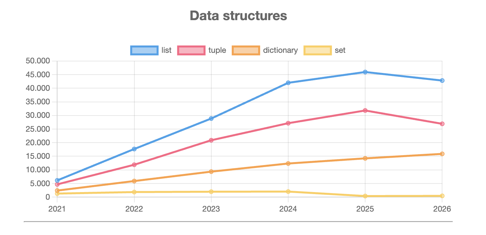

# Explorando evolução de código

Este documento apresenta as respostas do exercício de exploração de evolução de código, realizado com a ferramenta [GitEvo](https://github.com/andrehora/gitevo). O relatório `HTML` gerado está disponível neste repositório em [report_transformers.html](report_transformers.html).

## 1. Repositório selecionado

[huggingface/transformers](https://github.com/huggingface/transformers) — biblioteca em Python que reúne implementações de modelos de aprendizado de máquina para texto, imagem e áudio.

O relatório foi gerado com o comando:

```shell
$ gitevo -r python https://github.com/huggingface/transformers
```

## 2. Gráfico selecionado

Gráfico **Data structures**, que apresenta a evolução da quantidade de ocorrências das estruturas de dados `list`, `tuple`, `dictionary` e `set` no código do repositório, entre 2021 e 2026.



Os valores lidos do relatório são:

| Ano  | list   | tuple  | dictionary | set   |
| ---- | ------ | ------ | ---------- | ----- |
| 2021 | 6.132  | 4.681  | 2.404      | 1.300 |
| 2022 | 17.669 | 11.889 | 5.899      | 1.854 |
| 2023 | 28.868 | 20.885 | 9.356      | 1.985 |
| 2024 | 41.990 | 27.151 | 12.341     | 2.033 |
| 2025 | 45.948 | 31.817 | 14.234     | 387   |
| 2026 | 42.816 | 26.922 | 15.881     | 449   |

## 3. Explicação

### Evolução de 2021 a 2024

Nesse período, as quatro estruturas apresentam crescimento, em ritmos diferentes:

- **`list`** é a estrutura mais frequente em todos os anos e cresce de 6.132 para 41.990 ocorrências, ou seja, cerca de 6,8 vezes.
- **`tuple`** acompanha `list` com valores um pouco menores, de 4.681 para 27.151.
- **`dictionary`** cresce de forma mais suave, de 2.404 para 12.341, e se mantém abaixo de `list` e `tuple`.
- **`set`** é a menos utilizada e permanece praticamente estável, entre 1.300 e 2.033.

Esse crescimento é esperado, pois o repositório ganhou muitos modelos e funcionalidades nesse intervalo. Como o número de linhas de código aumenta, a quantidade de ocorrências de qualquer estrutura básica também tende a aumentar.

### Mudança de comportamento em 2025 e 2026

A partir de 2025, as curvas deixam de seguir o mesmo padrão:

- **`set`** sofre a maior alteração do gráfico: cai de 2.033 (2024) para 387 (2025), uma redução de cerca de 81%. Ela não chega a zero, como poderia parecer no gráfico por causa da escala, e em 2026 se mantém em um patamar baixo (449).
- **`list`** atinge o pico em 2025 (45.948) e cai cerca de 6,8% em 2026 (42.816).
- **`tuple`** atinge o pico em 2025 (31.817) e cai cerca de 15,4% em 2026 (26.922).
- **`dictionary`** é a única estrutura que continua crescendo, chegando a 15.881 em 2026, um aumento de cerca de 11,6% em relação a 2025. Desde 2021, o crescimento acumulado é de aproximadamente 6,6 vezes.

Os dados de 2026 correspondem a um ano ainda em andamento, portanto a queda de `list` e `tuple` pode estar parcialmente associada a esse fato e deve ser interpretada com cautela.

### Interpretação

Minha interpretação é que o gráfico indica um processo de **consolidação e simplificação do código**: após anos de crescimento acelerado, `list` e `tuple` deixam de aumentar e passam a diminuir, enquanto `dictionary` segue em alta. Uma hipótese é que estruturas de dados posicionais (listas e tuplas) estejam sendo substituídas por estruturas nomeadas (dicionários), que deixam o código mais legível e menos dependente da ordem dos elementos. Isso estaria de acordo com boas práticas de legibilidade e manutenção.

Essa hipótese, porém, tem limitações:

- A redução somada de `list` e `tuple` entre 2025 e 2026 (cerca de 8.000 ocorrências) é bem maior que o aumento de `dictionary` (cerca de 1.650). Logo, a troca direta de listas e tuplas por dicionários não explica sozinha a queda; é provável que parte do código tenha sido simplesmente removida ou reorganizada.
- O gráfico mostra a quantidade de ocorrências, mas não o motivo das mudanças. A queda brusca de `set` em 2025, em particular, sugere a remoção ou a reescrita de um conjunto grande de arquivos, o que só pode ser confirmado consultando o histórico de commits e a documentação do repositório.
